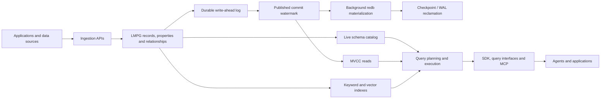

# RushDB 3 — Engineering Research

An engineering study of graph-native data modeling, live schema discovery, hybrid retrieval, and AI-agent integration in RushDB 3.

This repository brings together architecture analysis, implementation research, a TypeScript proof of concept, and evaluation guidance for engineers assessing RushDB in connected-data and agent-oriented systems.

## Architecture at a glance



The central engineering question is how a database can expose connected data and its observed structure to applications and agents, while retaining predictable query, security, and operational behaviour.

## Research areas

### Architecture and data model
- [Architecture overview](docs/architecture/overview.md)
- [LMPG and schema catalog](docs/architecture/lmpg-and-schema-catalog.md)
- [Storage, WAL, MVCC and transactions](docs/architecture/storage-and-transactions.md)

### Querying and agent integration
- [Hybrid retrieval](docs/architecture/hybrid-retrieval.md)
- [Agent discovery and MCP](docs/integrations/agent-discovery-and-mcp.md)
- [TypeScript proof of concept](examples/typescript/README.md)

### Operations and evaluation
- [Security and tenancy](docs/operations/security-and-tenancy.md)
- [Production evaluation checklist](docs/operations/production-checklist.md)
- [Database fit and comparison](docs/evaluation/database-fit.md)
- [Performance and benchmark methodology](docs/evaluation/performance-and-benchmarks.md)
- [Validation status](docs/evaluation/validation-status.md)

## Key engineering topics

- Labeled Meta-Property Graph (LMPG) and occurrence-oriented property storage.
- Catalog-driven discovery of labels, properties, types, and relationships.
- Schema drift and the boundary between structural metadata and business semantics.
- WAL durability, materialized state, MVCC snapshots, and transaction conflicts.
- Structured filters combined with keyword and vector retrieval.
- Self-hosted embedding responsibility and Cloud-managed capability distinctions.
- MCP-based discovery-first agent workflows.
- Tenant isolation, least-privilege access, observability, recovery, and workload benchmarking.

## TypeScript proof of concept

The example imports nested customer, order, and product records, inspects the live schema catalog, and queries a customer through a related order.

Prerequisites: a running RushDB 3 engine, a compatible Node.js release, and a local engine token.

```bash
brew install rush-db/tap/rushdb
export RUSHDB_TOKEN="$(openssl rand -hex 32)"
rushdb up --data-dir ./rushdb-poc-data
```

In another terminal:

```bash
cd examples/typescript
npm install
export RUSHDB_TOKEN="<local-engine-token>"
export RUSHDB_ENGINE_URL="http://127.0.0.1:3000"
npm run seed-and-inspect
```

Use a fresh data directory for each repeatable run. The example is a one-time seed and does not implement cleanup or upsert behaviour.

## Scope and reproducibility

This repository is an independent engineering study with a focused TypeScript proof of concept. The example demonstrates nested ingestion, live schema discovery, and a relationship query. The architecture documents analyze upstream RushDB capabilities; they do not reimplement the engine, MCP server, vector index, or hybrid retrieval pipeline.

**Research snapshot (21 November 2026):** RushDB engine 3.0.13, JavaScript SDK 3.4.1, MCP server reference 3.5.0, Node.js 18 or newer.

The TypeScript example includes assertions for the expected catalog entries and relationship-query result. Run it against a clean local engine data directory using the steps in [TypeScript proof of concept](examples/typescript/README.md). The evidence document records what is source-reviewed, statically checked, runtime-executed, or vendor-reported. Vendor benchmarks are not presented as independent results.

See [Validation and reproducibility](docs/evaluation/validation-status.md) for evidence boundaries and version-sensitive changes.

## Primary references

- [RushDB engine repository](https://github.com/rush-db/rushdb)
- [RushDB documentation](https://docs.rushdb.com/)
- [RushDB JavaScript SDK](https://github.com/rush-db/javascript-sdk)
- [RushDB MCP server](https://github.com/rush-db/mcp-server)

Product capabilities and compatibility are release-specific. Verify the exact engine, SDK, and MCP server versions used in any implementation or benchmark.

## Contributing

Corrections and reproducible evidence are welcome. Include the exact RushDB version, environment, command or query, expected result, observed result, and relevant source. Do not submit secrets or customer data.

## License

Original documentation and example code in this repository are licensed under the MIT License unless a file states otherwise. RushDB and its upstream components retain their respective licenses. See [LICENSE](LICENSE).
