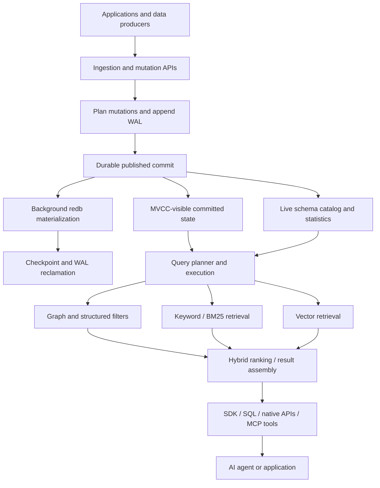

# RushDB 3 architecture overview

## Positioning

RushDB 3 is a standalone Rust database engine built around a Labeled Meta-Property Graph (LMPG), an automatically maintained schema catalog, and integrated structured, keyword, and vector retrieval. It should be evaluated as an agent-facing connected-data engine—not assumed to be a universal replacement for PostgreSQL, MongoDB, or Neo4j.

RushDB 2.x and 3.x are materially different generations: 2.x was built over Neo4j; 3.x is the standalone engine with its own storage and query implementation.

## Logical architecture

## Core idea

The database maintains an inspectable description of observed labels, properties, types, value information, and relationship shapes as data is committed. An agent can inspect that live description before constructing a query. This reduces dependence on stale schema descriptions embedded in prompts.

The catalog does not infer business definitions, resolve semantic renames, choose canonical fields, or migrate values without domain rules. Frequently filtered properties may also need explicit indexes.

## Authorization boundary

RushDB enforces configured database-level controls: credential permissions, tenant isolation, and tenant data-access policies that can restrict labels, traversable relationship types, visible properties, result counts, and catalog disclosures. These controls do not replace application identity management. The application remains responsible for authenticating end users, mapping users and agents to tenant-scoped capabilities, deciding which capability each agent receives, and enforcing business rules such as record ownership and domain-specific authorization. A model prompt is not an authorization boundary.

See [Security and tenancy](../operations/security-and-tenancy.md) for the distinction between engine-enforced controls and application responsibilities.

## Deployment distinction

- **Self-hosted engine:** application-managed embedding generation; local engine and direct integrations.
- **RushDB Cloud:** managed service with additional managed capabilities. Do not attribute Cloud-only features to the self-hosted binary.

## Diagram source

Editable Mermaid sources are in [`assets/diagrams/`](../../assets/diagrams/). The accompanying PNG/SVG illustrations are intended as reusable technical assets, not evidence of measured runtime behaviour.
