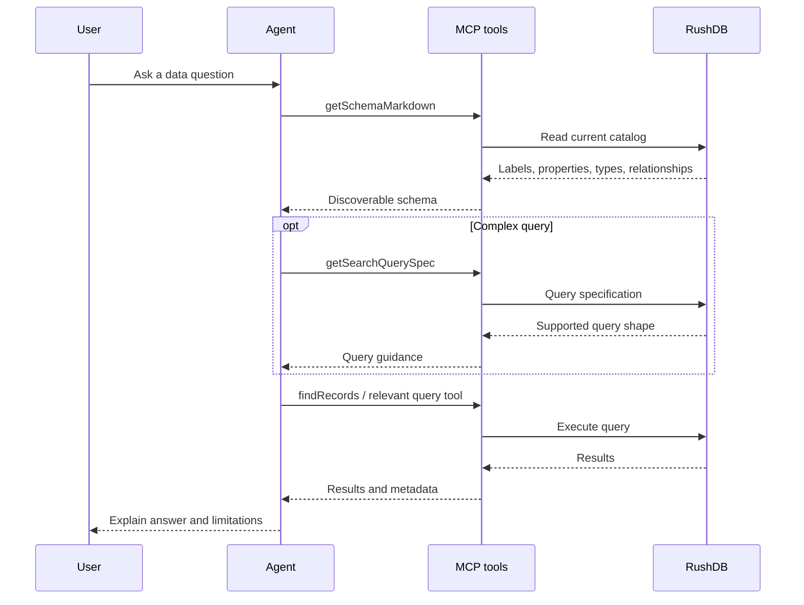

# Agent discovery and MCP workflow

## Recommended interaction loop



## Discovery-first sequence

1. Call `getSchemaMarkdown` at session start or when schema freshness is uncertain.
2. Identify the requested labels, properties, and relationship path from the returned catalog.
3. For complex traversal, aggregation, date, metric, or vector queries, consult `getSearchQuerySpec`.
4. Construct a query using exact discovered identifiers.
5. Execute and validate the result; refresh discovery after structural errors or known ingestion changes.

A short-lived schema cache can reduce repeated tool calls. Invalidate it on ingestion events or schema-related query errors. Measure the trade-off between discovery latency, prompt tokens, stale-schema errors, and query retries.

## MCP deployment modes

The self-hosted direct integration is a local stdio MCP process configured to reach the local RushDB engine. The hosted OAuth connector is a Cloud integration path. Do not conflate these deployment modes.

Example client configuration (replace the token with a secret injected locally):

```json
{
  "mcpServers": {
    "rushdb": {
      "command": "npx",
      "args": ["-y", "@rushdb/mcp-server"],
      "env": {
        "RUSHDB_MODE": "direct",
        "RUSHDB_ENGINE_URL": "http://127.0.0.1:3000",
        "RUSHDB_ENGINE_TOKEN": "${RUSHDB_ENGINE_TOKEN}"
      }
    }
  }
}
```

Check the current MCP server documentation for the exact environment-variable and client-configuration contract before deployment. Never commit real tokens or expose a full-access boot token to an agent that only needs read access.

## References

- [MCP integration](https://docs.rushdb.com/connect/mcp/)
- [JavaScript SDK](https://github.com/rush-db/javascript-sdk)
- [MCP server](https://github.com/rush-db/mcp-server)
