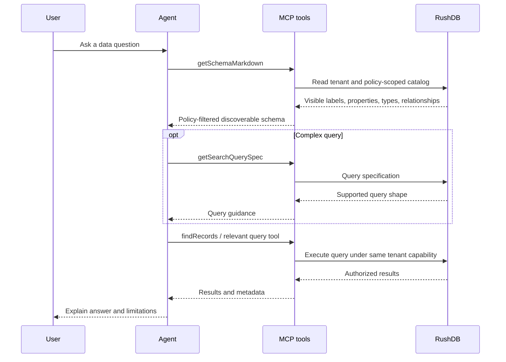

# Agent discovery and MCP workflow

## Recommended interaction loop



## Discovery-first sequence

1. Call `getSchemaMarkdown` at session start or when schema freshness is uncertain.
2. Treat the result as policy-filtered: it may not show every label or property stored in the tenant.
3. Identify requested labels, properties, and relationship paths from the returned catalog.
4. For complex traversal, aggregation, date, metric, or vector queries, consult `getSearchQuerySpec`.
5. Construct a query using exact discovered identifiers and execute it with the same tenant-scoped capability.
6. Validate the result; refresh discovery after structural errors or known ingestion changes.

A short-lived schema cache can reduce repeated tool calls. Invalidate it on ingestion events or schema-related query errors. Measure the trade-off between discovery latency, prompt tokens, stale-schema errors, and query retries.

## MCP deployment modes

The self-hosted direct integration is a local stdio MCP process configured to reach the local RushDB engine. The hosted OAuth connector is a Cloud integration path. Do not conflate these deployment modes.

Example client configuration (replace the token with a secret injected locally):

```json
{
  "mcpServers": {
    "rushdb": {
      "command": "npx",
      "args": ["-y", "@rushdb/mcp-server@3.5.0"],
      "env": {
        "RUSHDB_MODE": "direct",
        "RUSHDB_ENGINE_URL": "http://127.0.0.1:3000",
        "RUSHDB_ENGINE_TOKEN": "REPLACE_WITH_TENANT_SCOPED_CAPABILITY"
      }
    }
  }
}
```

For multitenant deployments, configure RUSHDB_ENGINE_SCOPE as required by the selected MCP server version and issue a capability bound to that tenant. Use the narrowest permission set required by the tools the agent will call. Never expose the boot token to an agent that only needs read access.

Check the current MCP server documentation for the exact environment-variable and client-configuration contract before deployment. The MCP server version in this research snapshot is 3.5.0; the TypeScript POC does not start or runtime-test an MCP server process.

## References

- [MCP integration](https://docs.rushdb.com/connect/mcp/)
- [JavaScript SDK](https://github.com/rush-db/javascript-sdk)
- [MCP server](https://github.com/rush-db/mcp-server)
